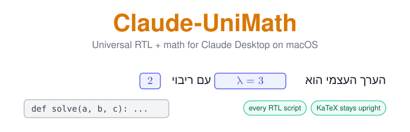
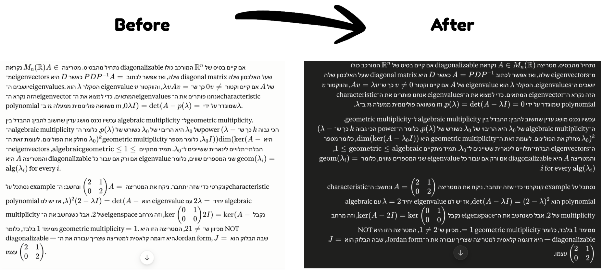
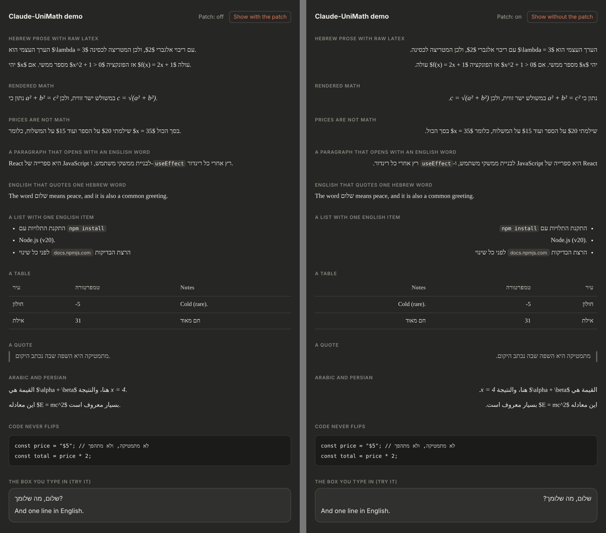

<div align="center">



# Claude-UniMath

**The first** RTL patch to bring proper **mathematics handling** to the Claude Desktop app on macOS.
Hebrew, Arabic, Persian, and every other right-to-left script — with LaTeX and KaTeX that stay upright and correct.

[](LICENSE)
[](#requirements)
[](#development--tests)
[](CHANGELOG.md)
[](https://github.com/DavidiBellaire)

</div>

---

## The problem

Claude Desktop has **no right-to-left support at all**. If you work in Hebrew, Arabic, or Persian, every long conversation is a struggle — and the moment Claude writes mathematics, it falls apart completely. A rendered formula or an inline `$x^2$` dropped into RTL prose gets scattered by naive direction-flipping, and the line becomes unreadable.

*While processing Hebrew with AI agents requires a higher token consumption, it remains the best alternative if language barriers limit your use of English.

Browser extensions solved this for **claude.ai** in the web browser. **Nobody solved it for the desktop app** — the [official Anthropic request](https://github.com/anthropics/claude-code/issues/38005) even notes that the Chrome extension *"works for web but not desktop,"* because injecting into Electron through the DevTools protocol fails. The desktop-only patches that do exist just flip whole lines and **leave math broken**.

**Claude-UniMath is the first to bring isolated-math RTL handling to the macOS desktop app.**

## See it

> Hebrew flows right-to-left, every formula stays an upright left-to-right island, code stays LTR.

<table>
  <tr>
    <td>
      
    </td>
  </tr>
</table>


## Why it is different

Every other RTL patch answers one question: *"is there an RTL character? then align the line right."* That breaks on mixed content. Claude-UniMath is built on a different idea — **isolation, not line-flipping**:

| | Other desktop patches | Browser extensions | **Claude-UniMath** |
|---|:---:|:---:|:---:|
| Works on the **macOS desktop app** | ✅ | ❌ | ✅ |
| **Math** isolated correctly in RTL text | ❌ | ✅ | ✅ |
| Rendered **KaTeX** *and* raw **LaTeX** | ❌ | partial | ✅ |
| **Currency-aware** (`$20` ≠ math) | ❌ | ❌ | ✅ |
| **Every** RTL Unicode script | partial | partial | ✅ |
| Live during **streaming** | ✅ | ✅ | ✅ |
| **Non-destructive** (original app untouched) | varies | n/a | ✅ |
| **Tested** (144 assertions) | ❌ | ❌ | ✅ |

<details>
<summary><b>The three ideas no one else implements on desktop</b> (click to expand)</summary>

<br>

- **Math isolation, not line flipping.** Each formula becomes a `unicode-bidi: isolate` left-to-right island. `הערך העצמי הוא $\lambda = 3$ עם ריבוי $2$` renders with the Hebrew flowing right and the formula upright and correct, exactly where it belongs.
- **Currency-aware LaTeX detection.** A bare `$` from a price (`$20`) is never mistaken for math — and, critically, it is never allowed to "steal" the closing delimiter of real math later on the same line. `שילמתי $20 עבור $x^2 + 1$` isolates only `$x^2 + 1$`.
- **Universal RTL coverage.** Not just Hebrew and Arabic — every right-to-left Unicode block, including Persian, Urdu, Syriac, Thaana, N'Ko, and astral-plane scripts like Adlam.

It also isolates **citation chips and inline UI atoms** so they sit on the correct side of an RTL line, handles content **live as it streams**, and is fully **idempotent** — re-processing never double-wraps or corrupts anything.

</details>

<details>
<summary><b>What it handles</b> (new in 1.1)</summary>

<br>

- **Direction follows the language, not one stray word.** A block is RTL when it starts with an RTL letter, or when RTL letters are a real share of its letters. `React היא ספרייה של פייסבוק` is RTL even though it opens in English, and `The word שלום means peace` stays LTR. Math and code are left out of the count.
- **Plain inline math.** `$x$`, `$n+1$` and `$f(x) = 2x + 1$` are recognised without needing a LaTeX command, using the same delimiter rule TeX-aware Markdown parsers use. `$20 and $30`, `$5-$10` and `בין $5 ל-$10` are still prices.
- **Raw environments.** `\begin{pmatrix} … \end{pmatrix}` and friends are isolated like any other formula.
- **Tables.** Columns run right-to-left when the header row is mostly RTL. Cells such as `-5` or `Cold (rare).` keep their sign and punctuation in the right place.
- **Lists.** A list is mirrored when at least half of its items are RTL, and an English item inside it stays readable and lined up with the rest.
- **Quotes.** The bar moves to the right edge.
- **The box you type in.** Every line finds its own direction, so a Hebrew line and an English line can sit in the same message.
- **Every script counts.** Greek, Cyrillic, accented Latin and CJK are treated as left-to-right letters, not skipped.
- **Streaming-safe.** While the app marks a reply as still streaming, its text is not rewritten under the app's own renderer. Direction, rendered math, lists and tables stay live, and raw LaTeX is isolated the moment the reply is complete.
- **Reversible on the page.** Any style the patch changes is remembered and put back if a block stops being RTL.

</details>

## Try it without installing

Open [`demo/index.html`](demo/index.html) in any browser. It runs the real payload over sample content, with a switch to see the same page without the patch.

<table>
  <tr>
    <td>
      
    </td>
  </tr>
</table>

## Quick start

```bash
git clone https://github.com/DavidiBellaire/Claude-UniMath.git
cd Claude-UniMath
chmod +x install.sh        # only needed if you downloaded the ZIP
./install.sh --install
```

A patched copy is built at `~/Applications/Claude-UniMath.app` and launches automatically. **Your original `/Applications/Claude.app` is never touched.**

<details>
<summary><b>First launch: Gatekeeper & Keychain prompts (both expected)</b></summary>

<br>

- **Gatekeeper** — the copy is ad-hoc signed (not by Anthropic), so macOS may warn on first launch. Right-click the app → **Open**, or **System Settings → Privacy & Security → Open Anyway**.
- **Keychain** — macOS asks to allow access to "Claude Safe Storage". The copy has a different signature than the original, so macOS re-asks once. Safe to approve.

</details>

## Usage

```bash
./install.sh --install      # Install, or re-apply after a Claude update
./install.sh --uninstall    # Remove the patched copy
./install.sh --status       # Show install status, fuse state, and whether Claude was updated since
./install.sh --version      # Show the Claude-UniMath version
./install.sh                # Interactive menu
```

Type or read any RTL language and it aligns automatically. Math stays upright and correct.

## Requirements

- **macOS** (tested on macOS 15 / macOS 26)
- **Claude Desktop** at `/Applications/Claude.app`
- **Node.js** v16+ ([nodejs.org](https://nodejs.org/) or `brew install node`) — provides `npx` for `@electron/asar` and `@electron/fuses`
- **Xcode Command Line Tools** (`xcode-select --install`) — provides `codesign`

<details>
<summary><b>How it works</b> (the patching pipeline)</summary>

<br>

The patcher is non-destructive — it **never modifies** the original app. Instead it:

1. Copies `Claude.app` → `~/Applications/Claude-UniMath.app`
2. Extracts the Electron `app.asar` archive
3. Prepends the Claude-UniMath payload to the renderer JavaScript
4. Repacks the archive
5. Disables the `EnableEmbeddedAsarIntegrityValidation` Electron fuse (required — Electron validates the archive hash at startup and would otherwise refuse to launch the modified copy)
6. Re-signs the copy with an ad-hoc signature, preserving the original entitlements

Because it builds a separate copy, no `sudo` is ever needed, your original Claude keeps auto-updating normally, and if anything goes wrong you just delete the copy.

**After a Claude update:** the auto-updater only touches the original. Re-run `./install.sh --install` to rebuild a fresh patched copy from the updated version.

</details>

## Development & tests

The engine is split so the logic is testable in isolation from Electron:

```bash
npm install        # installs jsdom (dev dependency) for the DOM tests
npm test           # full suite — 144 assertions, 0 failures
npm run build      # regenerate src/payload.js after changing the sources
```

`src/core.js` is pure and DOM-free. `src/dom.js` applies its decisions to the page, and `src/runtime.js` wires both to a live window. `src/payload.js`, the one file the installer injects, is **generated** from those three by `scripts/build.js`. The suite fails if it is out of date, and then runs the generated file itself inside a simulated page, so the code that is tested is exactly the code that ships.

```
Claude-UniMath/
├── install.sh          # macOS patcher (copy → inject → repack → sign)
├── assets/
│   └── banner.svg      # README banner
├── src/
│   ├── core.js         # Pure BiDi + math-detection engine (DOM-free, testable)
│   ├── dom.js          # DOM layer: math islands, prose direction, lists, tables, quotes
│   ├── runtime.js      # Stylesheet, typing box, streaming observer
│   └── payload.js      # GENERATED: the self-contained file injected into Claude Desktop
├── scripts/
│   └── build.js        # Builds src/payload.js from the three sources
├── demo/
│   └── index.html      # See the patch in any browser, no install needed
├── test/
│   ├── core.test.js    # RTL detection, base direction, math vs currency
│   ├── dom.test.js     # isolation, direction, lists, tables, quotes, streaming
│   └── payload.test.js # the shipped file: up to date, start-up, observer, typing box
├── CHANGELOG.md
├── package.json
├── LICENSE
└── README.md
```

## Troubleshooting

<details>
<summary><b>"Claude quit unexpectedly" on launch</b></summary>
<br>
The ASAR integrity fuse wasn't disabled. Re-run <code>./install.sh --install</code>. If it persists, confirm <code>npx</code> works: <code>npx --yes @electron/fuses --help</code>.
</details>

<details>
<summary><b>No RTL alignment</b></summary>
<br>
Make sure you're running <code>Claude-UniMath.app</code> from <code>~/Applications/</code>, not the original. Check Console.app for <code>[Claude-UniMath]</code> messages.
</details>

<details>
<summary><b><code>.vite/build/ not found</code></b></summary>
<br>
A Claude update changed the internal structure. This is the first place to look when a new version breaks the patch.
</details>

## A note on responsibility

This patch modifies Claude Desktop's internal files, which Anthropic does not officially support and which may be against their Terms of Service. It is provided as-is, for personal use, with no warranty. Use at your own discretion. The real fix is native RTL support in Claude — if you want that, add your voice to [the official request](https://github.com/anthropics/claude-code/issues/38005).

## License

© 2026 Davidi Bellaire. All rights reserved.

Claude-UniMath is free to install and use. Copying, redistributing, publishing modified versions or selling it requires written permission. The full terms are in [LICENSE](LICENSE). Versions published before 16 November 2026 were released under the MIT License.
